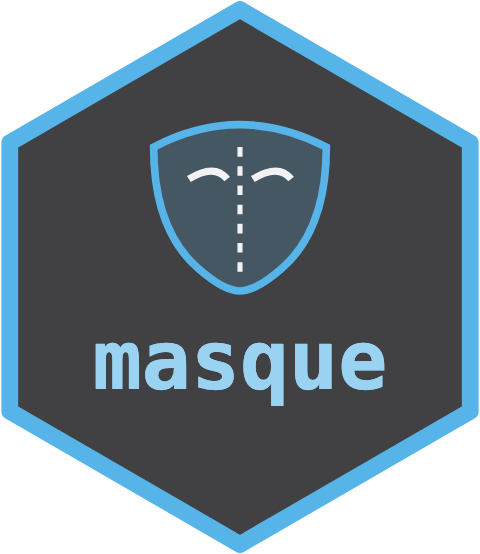

# masque 

<!-- badges: start -->
[](https://lifecycle.r-lib.org/articles/stages.html#experimental)
[](https://github.com/max578/masque/actions/workflows/R-CMD-check.yaml)
[](https://app.codecov.io/gh/max578/masque)
[](https://max578.r-universe.dev/masque)
[](https://max578.github.io/masque/)
<!-- badges: end -->

> Structurally faithful development surrogates for tabular data.

`masque` makes a synthetic copy of a confidential table that keeps its
design, missing values and correlations. Analysts write and test code on
the copy. The data custodian then runs the finished code on the real data,
using a private recipe that translates names and labels.

It is for custodians of confidential research data who want an outside
analyst to build the analysis without seeing the data, and for the analysts
who build it. The input can be a single table, a folder of files or a
multi-sheet workbook.

**Security note.** Clones made with masque 0.13.0 or earlier can reveal
which alias stands for which label. If you shared one, make it again with
0.14.0 and share the new clone instead. The same seed gives the same
values.

The [changelog](https://max578.github.io/masque/news/index.html) lists
what changed in each release.

Every table masque returns is a `data.table`.

---

## Installation

Pre-built binaries from r-universe:

```r
install.packages(
  "masque",
  repos = c("https://max578.r-universe.dev", "https://cloud.r-project.org")
)
```

Or from GitHub:

```r
# install.packages("pak")
pak::pak("max578/masque")
```

---

## Two-minute example

```r
library(masque)

# Read a small public fixture (alpha-design field trial; John & Williams, 1995).
f  <- system.file("extdata", "john_alpha.csv", package = "masque")
df <- read.csv(f, stringsAsFactors = TRUE)

# One guided call: read -> propose roles -> (review) -> mask -> audit.
# In an interactive session it pauses to let you review the plan;
# ask = FALSE skips the pause.
m <- masque(df, mode = "collaborate", seed = 1L)

synth <- synthetic(m)   # hand this to the analyst
rec   <- recipe(m)      # keep this private

# Analyst builds a pipeline against the synthetic namespace ...
fit <- lm(yield ~ gen + rep, data = synth)

# ... and the custodian re-targets it to the original data.
preds <- predict(fit, newdata = apply_recipe(df, rec))

# A description of the clone the analyst can plan with: sizes, roles and
# counts, never a value.
card <- data_card(m, name = "alpha_trial")
```

A folder of files or a multi-sheet workbook works the same way. Pass the
path to `masque()` and it masks every table at once, aliasing shared keys
consistently so the synthetic tables still join.

If the table needs tidying first, `clean_table()` makes column names valid
and trims whitespace, and `conform_table()` merges near-duplicate labels
and sets column types, reporting each change.

### Multi-environment trials

`detect_design()` recognises environment columns, such as site or year, and
the design within each environment. In collaborate mode the environment
labels are aliased and every row stays in its environment. The clone does
not keep genotype-by-environment effects, so it is no substitute for the
real data in scientific inference.

---

## Threat model

`masque` is **not** a privacy-preserving or differential-privacy tool. It is a
**structurally faithful development surrogate** with explicit confidentiality
guardrails. Read
[Confidentiality and the threat model](https://max578.github.io/masque/articles/confidentiality.html)
before using it.

**What `masque` does**

- Preserves enough structure for pipelines to run unchanged.
- Provides two explicit modes: `local` for owner-only realistic surrogates,
  and `collaborate` for controlled sharing with opaque aliasing (numeric
  doses included), numeric jitter, and an automatic leakage audit.
  Collaborate mode drops identifiers and free text (character columns in
  which most values are distinct), and refuses to re-simulate a table of
  fewer than five rows.
- Synthesises a column that is constant within a trial or site once per
  unit, so the clone keeps one value per trial, and keeps linked event
  times in order (`events =`).
- Keeps treatment, block and environment means on request
  (`conditional = TRUE`). Treatment means on the clone then track those of
  the real data, and block and environment effects stay detectable.
  [What a conditional clone keeps of the design](https://max578.github.io/masque/articles/design_preservation.html)
  tests this on eight field designs.
- Records every translation (column names, factor levels) in a private
  `recipe`. The recipe holds the real labels, the original column names and
  the seed, so together with the synthetic it undoes every alias. Keep it
  with the original data and never send it with the synthetic.
- Audits its own output (`audit_mask()`), raises HIGH findings as classed
  warnings the guided flow never silences, and refuses package-managed writes
  while a HIGH finding stands (an explicit `allow_high = TRUE` override is
  available, warned and recorded in the recipe).

**What `masque` does not do**

- It is not a universal anonymiser, and it does not provide
  differential-privacy guarantees.
- It does not make outputs safe for public release.
- It does not anonymise rare strata, small designs, or operational metadata
  (small site-by-year combinations, contact names, geolocations).
- It does not certify compliance with any privacy, health, banking, or
  research-governance obligation. It can contribute evidence to such a
  decision; the decision itself is organisational and legal.
- It does not rewrite arbitrary pipeline source code.

**Bottom line.** Generating a synthetic table is not a release decision.
In the Five Safes framework for controlled data access, `masque`
contributes to *Safe Data* and *Safe Outputs*;
Safe People, Safe Projects, and Safe Settings are governance questions no
package can answer. The collaborate workflow assumes only the synthetic
crosses the trust boundary.

---

## Related packages

- [synthpop](https://CRAN.R-project.org/package=synthpop) makes synthetic
  versions of confidential microdata for release, synthesising one
  variable at a time from conditional models, and measures their utility
  and disclosure risk.
- [sdcMicro](https://CRAN.R-project.org/package=sdcMicro) anonymises
  microdata for public- and scientific-use files and estimates
  disclosure risk.

Both produce data meant to be analysed in place of the original. masque
produces a development copy: analysts write code on it and the custodian
runs that code on the real data through the private recipe. It keeps the
experimental design (treatments, blocks, plots), and a conditional clone
(`conditional = TRUE`) also keeps the treatment means of the outcome.
Every column's role and action is checked against a fixed vocabulary
before anything is masked.

## Documentation

Articles, in reading order:

1. [Getting started with masque](https://max578.github.io/masque/articles/getting_started.html):
   the one-call path on a public fixture.
2. [Recipe anatomy and the round-trip](https://max578.github.io/masque/articles/recipe_anatomy.html):
   what a recipe holds and how a pipeline built on the synthetic runs on
   the original.
3. [Confidentiality and the threat model](https://max578.github.io/masque/articles/confidentiality.html):
   what a clone protects, the two modes, and the depth controls.
4. [What a conditional clone keeps of the design](https://max578.github.io/masque/articles/design_preservation.html):
   eight classic field designs tested against one pass rule.

The [function reference](https://max578.github.io/masque/reference/index.html)
documents every exported function. Also on the site:
[API stability policy](https://max578.github.io/masque/API_STABILITY.html),
[changelog](https://max578.github.io/masque/news/index.html),
[contributing guide](https://max578.github.io/masque/CONTRIBUTING.html) and
[licence](https://max578.github.io/masque/LICENSE.html).

---

## Contributing

Bug reports and suggestions are welcome as
[GitHub issues](https://github.com/max578/masque/issues). Read the
[contributing guide](https://max578.github.io/masque/CONTRIBUTING.html)
before opening a pull request.

---

## Citation

```r
citation("masque")
```

The package also ships a `CITATION.cff` file.

---

## License

MIT. See the [licence](https://max578.github.io/masque/LICENSE.html).
