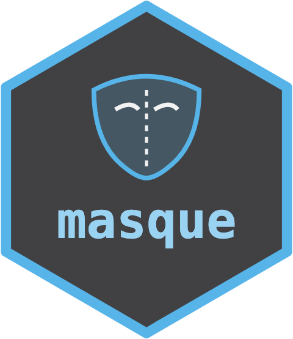

# masque 

<!-- badges: start -->
[](https://lifecycle.r-lib.org/articles/stages.html#experimental)
[](https://github.com/max578/masque/actions/workflows/R-CMD-check.yaml)
[](https://app.codecov.io/gh/max578/masque)
[](https://max578.r-universe.dev/masque)
[](https://max578.github.io/masque/)
<!-- badges: end -->

> Synthetic copies of confidential data tables, for writing analysis code without the real data.

`masque` makes a synthetic copy of a confidential table. Analysts write and
test code on the copy without seeing the real values. The data owner then
runs the finished code on the real data, using a private recipe that maps
the codes in the copy back to the real labels.

By default, every outcome and covariate is simulated independently, with no
link to other columns or to the real rows. Each numeric column keeps only
its approximate range and shape. The experimental design and the pattern of
missing values are kept exactly, and category labels are replaced by codes.
When the code needs correlations between columns, use
`mode = "collaborate"`, or `mode = "local"` if the copy will not leave the
data owner. Treatment effects also need `conditional = TRUE`. Each step
discloses more about the real data, and masque gives no formal privacy
guarantee.

It is for owners of confidential research data who want an outside analyst
to build the analysis without seeing the real values, and for the analysts
who build it. The input can be a single table, a folder of files or a
multi-sheet workbook.

**Security note.** Clones made with masque 0.13.0 or earlier can reveal
which alias stands for which label. If you shared one, make it again with
0.14.0 and share the new clone instead. The same seed gives the same
values.

The [changelog](https://max578.github.io/masque/news/index.html) lists
what changed in each release.

Every table masque returns is a `data.table`.

---

## Installation

Pre-built binaries from r-universe:

```r
install.packages(
  "masque",
  repos = c("https://max578.r-universe.dev", "https://cloud.r-project.org")
)
```

Or from GitHub:

```r
# install.packages("pak")
pak::pak("max578/masque")
```

---

## Two-minute example

```r
library(masque)

# Read a small public fixture (alpha-design field trial; John & Williams, 1995).
f  <- system.file("extdata", "john_alpha.csv", package = "masque")
df <- read.csv(f, stringsAsFactors = TRUE)

# One guided call: read -> propose roles -> (review) -> mask -> audit.
# In an interactive session it pauses to let you review the plan;
# ask = FALSE skips the pause. The default copy keeps the design and the
# missing values; every other value is drawn independently.
m <- masque(df, seed = 1L)

synth <- synthetic(m)   # hand this to the analyst
rec   <- recipe(m)      # keep this private

# Analyst builds a pipeline against the synthetic namespace ...
fit <- lm(yield ~ gen + rep, data = synth)

# ... and the data owner re-targets it to the original data.
preds <- predict(fit, newdata = apply_recipe(df, rec))

# A description of the clone the analyst can plan with: sizes, roles and
# counts, never a value.
card <- data_card(m, name = "alpha_trial")
```

A folder of files or a multi-sheet workbook works the same way. Pass the
path to `masque()` and it masks every table at once, aliasing shared keys
consistently so the synthetic tables still join.

If the table needs tidying first, `clean_table()` makes column names valid
and trims whitespace, and `conform_table()` merges near-duplicate labels
and sets column types, reporting each change.

### Multi-environment trials

`detect_design()` recognises environment columns, such as site or year, and
the design within each environment. By default, and in collaborate mode,
the environment labels are replaced by codes and every row stays in its
environment. The clone does
not keep genotype-by-environment effects, so it is no substitute for the
real data in scientific inference.

---

### Known-truth controls

A pipeline developed on the clone can be checked against datasets in which
the answer is known. A control spec, declared once, names the column to
reassign, the design strata it is permuted within, the outcome an
effect is planted on and the size of that effect. From it, `controls()`
derives a null (every analysed column permuted), negative replicates (one
column permuted within strata) and positive replicates (the negative plus
the planted shift), by permutation alone. The same spec runs on the clone
for the analyst and, with a private seed, on the original for the owner,
who returns a verdict about the pipeline rather than a dataset.

```r
spec <- control_spec(on = "gen", target = "yield", effect = list(sd = 0.5),
                     strata = "rep", n = 19L, seed = 2026L)
ctl <- controls(synthetic(m), roles(m), spec)
control_table(ctl, "positive", 1L)
```

A `masque_plan()` holds the roles and the spec together, so the spec is fixed
before any real result exists. `mask(df, plan)` resolves it on the source,
`handover()` gives the analyst the clone and the plan in clone vocabulary, and
`controls(real, plan, recipe = rec)` runs it on the owner's side.

## Threat model

`masque` gives no formal privacy guarantee such as differential privacy. It
makes copies for writing analysis code, with explicit confidentiality
safeguards. Read
[Confidentiality and the threat model](https://max578.github.io/masque/articles/confidentiality.html)
before using it.

**What `masque` does**

- Preserves enough structure for pipelines to run unchanged.
- Provides three modes.
  - `null`, the default, keeps the design and the missing values exactly.
    It draws each numeric value from its column's 1st percentile, deciles
    and 99th percentile, and each categorical value uniformly over the
    column's levels, which are renamed to codes.
  - `local` keeps the real structure (correlations, and real labels unless
    you code them). It keeps identifiers and free text and runs no audit,
    so its output is for the data owner only.
  - `collaborate` keeps the correlations, replaces treatment and category
    labels with codes (numeric treatment levels included), adds small
    random noise within each value's measurement resolution, and runs the
    leakage audit.
- In the null and collaborate modes, columns that look like identifiers or
  free text are dropped. They are found by name (such as `id`, `email` or
  `farmer`) or by mostly distinct character values, so a numeric identifier
  with an ordinary name can pass: review the proposed roles. A column that
  would be resampled from a table of fewer than five rows is refused.
- The leakage audit compares the copy with the original, column by column
  and for the table as a whole. A HIGH finding raises a warning and blocks
  masque's own writers until it is resolved or overridden.
- Synthesises a column that is constant within a trial or site once per
  unit, so the clone keeps one value per trial, and keeps linked event
  times in order (`events =`).
- Keeps treatment, block and environment means on request
  (`conditional = TRUE`, in local or collaborate mode). Treatment means on
  the clone then track those of the real data, and block and environment
  effects stay detectable.
  [What a conditional clone keeps of the design](https://max578.github.io/masque/articles/design_preservation.html)
  tests this on eight field designs.
- Records every translation (column names, factor levels) in a private
  `recipe`. The recipe holds the real labels, the original column names and
  the seed, so together with the synthetic it undoes every alias. Keep it
  with the original data and never send it with the synthetic.
- Audits its own output (`audit_mask()`), raises HIGH findings as classed
  warnings the guided flow never silences, and refuses package-managed writes
  while a HIGH finding stands (an explicit `allow_high = TRUE` override is
  available, warned and recorded in the recipe).

**What `masque` does not do**

- It is not a universal anonymiser, and it does not provide
  differential-privacy guarantees.
- It does not make outputs safe for public release.
- It does not anonymise rare strata, small designs, or operational metadata
  (small site-by-year combinations, contact names, geolocations).
- It does not certify compliance with any privacy, health, banking, or
  research-governance obligation. It can contribute evidence to such a
  decision; the decision itself is organisational and legal.
- It does not rewrite arbitrary pipeline source code.

**Bottom line.** Generating a synthetic table is not a release decision.
In the Five Safes framework for controlled data access, `masque`
contributes to *Safe Data* and *Safe Outputs*;
Safe People, Safe Projects, and Safe Settings are governance questions no
package can answer. The collaborate workflow assumes only the synthetic
crosses the trust boundary.

---

## Related packages

- [synthpop](https://CRAN.R-project.org/package=synthpop) makes synthetic
  versions of confidential microdata for release, synthesising one
  variable at a time from conditional models, and measures their utility
  and disclosure risk.
- [sdcMicro](https://CRAN.R-project.org/package=sdcMicro) anonymises
  microdata for public- and scientific-use files and estimates
  disclosure risk.

Both produce data meant to be analysed in place of the original. masque
produces a development copy: analysts write code on it and the data owner
runs that code on the real data through the private recipe. It keeps the
experimental design (treatments, blocks, plots), and a conditional clone
(`conditional = TRUE`) also keeps the treatment means of the outcome.
Every column's role and action is checked against a fixed vocabulary
before anything is masked.

## Documentation

Articles, in reading order:

1. [Getting started with masque](https://max578.github.io/masque/articles/getting_started.html):
   the one-call path on a public fixture.
2. [Recipe anatomy and the round-trip](https://max578.github.io/masque/articles/recipe_anatomy.html):
   what a recipe holds and how a pipeline built on the synthetic runs on
   the original.
3. [Confidentiality and the threat model](https://max578.github.io/masque/articles/confidentiality.html):
   what a clone protects, the three modes, and the depth controls.
4. [What a conditional clone keeps of the design](https://max578.github.io/masque/articles/design_preservation.html):
   eight classic field designs tested against one pass rule.

The [function reference](https://max578.github.io/masque/reference/index.html)
documents every exported function. Also on the site:
[API stability policy](https://max578.github.io/masque/API_STABILITY.html),
[changelog](https://max578.github.io/masque/news/index.html),
[contributing guide](https://max578.github.io/masque/CONTRIBUTING.html) and
[licence](https://max578.github.io/masque/LICENSE.html).

---

## Contributing

Bug reports and suggestions are welcome as
[GitHub issues](https://github.com/max578/masque/issues). Read the
[contributing guide](https://max578.github.io/masque/CONTRIBUTING.html)
before opening a pull request.

---

## Citation

```r
citation("masque")
```

The package also ships a `CITATION.cff` file.

---

## Acknowledgement

masque is developed within Analytics for the Australian Grains Industry
(AAGI), funded by the Grains Research and Development Corporation (GRDC) under
project UOA2301-005OPX.

---

## License

MIT. See the [licence](https://max578.github.io/masque/LICENSE.html).
